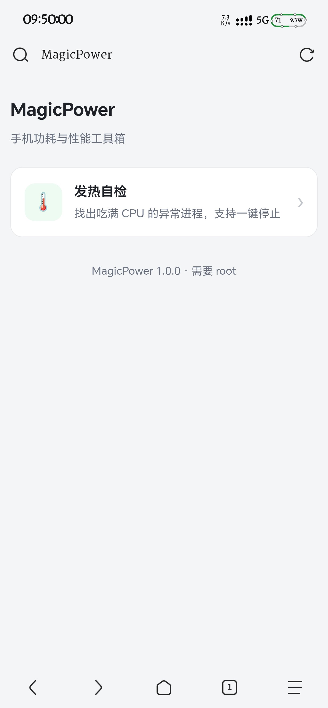
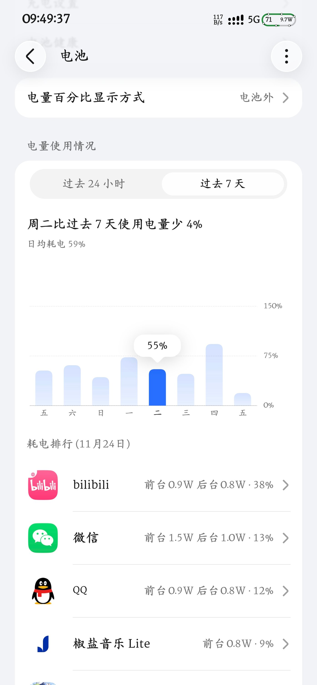
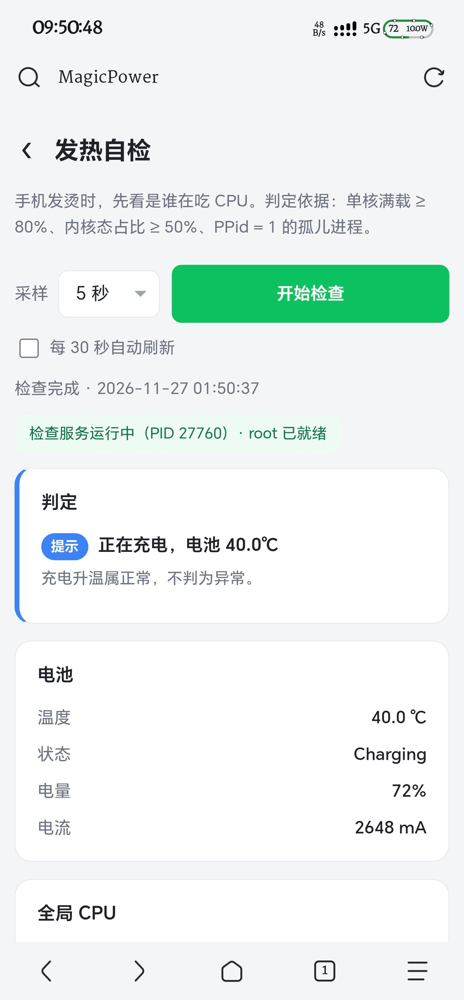

# MagicPower

> **使用声明**
>
> 本项目仅供个人在自己设备上学习、研究，以及备份自己拥有的数据。
> 禁止在国内社交平台宣传、推荐、引流本项目，包括但不限于：B 站、抖音、快手、贴吧、酷安、小红书、微博、知乎、微信公众号/视频号。

在荣耀「系统管家」的电池页里，给耗电排行中的每个 App 追加 **前台 / 后台功耗（W）** 估算，并把耗电百分比放在最后。

> 这是基于系统 BatteryStats 估算值的二次换算，不是电流表实测。适合看趋势和横向比较，不适合当作精确功耗仪。

## 截图

| 首页 | 电池页功耗标注 | 发热自检 |
|:---:|:---:|:---:|
|  |  |  |
| 打开即是功能入口 | 在耗电排行里标注前台/后台功耗 | 定位并停止异常进程 |

## 功能

- **24 小时 / 过去 7 天 / 7 天里选单日 / 单小时** 四个视图都支持；
- 每行显示 `前台 x.xW 后台 y.yW · 31%`，前台包含该时段的屏幕功率估算；
- 小时视图精确到 0.01W，低于 0.01W 的分量不显示；
- 只给耗电占比 >3% 的 App 标注，减少低占比噪声；
- 后台样本不足 120 秒、或换算结果 >10W 时不显示后台值；
- 屏幕功率只统计有亮屏记录的整点，单小时 >6W 视为异常整点剔除；
- 实时读取系统管家自己的 `smartpowerprovider` 数据，按天/按小时缓存；
- **应用内发热自检页**：桌面图标打开即是诊断页面，检查逻辑与 `tools/thermal-check.sh` 同源。

## 异常发热自检（tools/thermal-check.sh）

电池页能告诉你「哪个 App 耗电多」，但回答不了「为什么突然发烫」。真正把手机烤热的，常常是一个进程**单核满载空转**——典型是父进程退出的孤儿进程卡在 syscall 自旋里。这类进程在耗电排行里往往看不出来，只能靠 `/proc` 的 CPU 增量抓。

`tools/thermal-check.sh` 就是干这个的（需要 root）：

```sh
su -c 'sh thermal-check.sh'      # 默认采样 5 秒
su -c 'sh thermal-check.sh 10'   # 自定义采样窗口
```

输出包含电池温度/电流、温度传感器、全局 CPU 与内核态占比、CPU 占用 Top5，并给出判定：

- **单核满载**：该进程 CPU ≥ 80%（单核为 100%）；
- **内核态主导**：`stime / (utime + stime) ≥ 50%`；
- **孤儿进程**：`PPid == 1`，原父进程已退出。

前两条同时命中提示 syscall 自旋，三条全中即高度可疑，脚本直接给出待核实的 PID。**它只做诊断，不会自动结束任何进程。**

> 必须 root：Android 的 `/proc` 挂载为 `hidepid=invisible`，非 root 只能看到同 uid 的进程（本机实测 uid 1000 仅可见 47/936 个），会漏掉真正的元凶。
>
> 阈值来自一次真实故障：某常驻 Node 代理服务的父进程退出后，孤儿进程在 syscall 自旋里空转 22 小时，单核 98%（内核态 59%），大核 84.1℃，电池 47℃。

## 网页检查面板（web/）

浏览器读不到 `/proc`，也拿不到电池温度，所以检查必须在能读系统节点的地方做。`web/` 是一个 Go 服务 + 单页前端：

- 后端直接读 `/proc`、`/sys`，判定逻辑与 `tools/thermal-check.sh` 一致；
- 前端是原生 HTML/CSS/JS，白色主题，手机自适应；
- 结果页带**一键复制日志**，方便贴到 issue 或发给别人；
- 支持「每 30 秒自动刷新」，方便盯温度变化。

### 构建与运行

```sh
cd web
go build -o magicpower-check .
su -c './magicpower-check -addr 127.0.0.1:8787'
```

然后手机浏览器打开 <http://127.0.0.1:8787>。采样窗口在页面里选（3 / 5 / 10 秒）。

| 参数 | 默认 | 说明 |
|---|---|---|
| `-addr` | `127.0.0.1:8787` | 监听地址；默认只监听回环口 |

> 同样需要 root：`/proc` 是 `hidepid=invisible`，普通应用看不到其他进程的 CPU 数据，会漏掉真正的元凶。

### 停止异常进程

可疑项右侧有「停止进程」按钮，点击后二次确认。服务端有四道校验，任何一条不满足都会拒绝并返回原因：

| 校验 | 规则 |
|---|---|
| 令牌 | 必须带本次检查下发的 `stopToken`，挡住任意网页向 `127.0.0.1` 发 POST 误杀进程 |
| 时效 | 只认 5 分钟内的检查结果 |
| 名单 | PID 必须出现在最近一次检查里，且判定为 danger / warn |
| 身份 | `uid >= 10000` 的普通应用放行；`uid < 10000` 的进程只有可执行文件或命令行指向 `/data` 才放行，`system_server`、`surfaceflinger` 这类系统服务一律拒绝 |

停止时先发 `SIGTERM`，2 秒后仍在则发 `SIGKILL`；成功后会提示「已结束（SIGTERM）」或「SIGTERM 无效，已用 SIGKILL 结束」，并自动重新检查。

**强制停止**：被判定为「系统进程」的项（常见于你自己用 root 跑的程序，命令行不带 `/data`），页面会再弹一次风险说明，确认后可以强制停止。但 `init`、`system_server`、`zygote`、`surfaceflinger`、`com.android.systemui` 这类关键进程即使强制也会被拒绝。

失败不会静默。接口拒绝的进程，确认用途后也可以自己手动执行：

```sh
su -c 'kill -9 <pid>'
```

## 支持环境

| 项目 | 要求 |
|---|---|
| 系统 | 荣耀 MagicOS 11 / Android 17（BRT-AN00 实测） |
| 框架 | LSPosed，libxposed API 102+ |
| 作用域 | `com.hihonor.systemmanager` |

系统管家版本变化后类名/字段可能被 R8 改名，模块会静默失效；需要按新版本重新核对注入点。

## 安装

1. 签名并安装 APK（本仓库只提供未签名产物）。安装后桌面会出现 **MagicPower** 图标，点开就是发热自检页。
2. LSPosed → 模块 → 启用 MagicPower，作用域勾选 `com.hihonor.systemmanager`。
3. 强行停止一次系统管家，再打开 设置 → 电池。

> 包名 `io.github.jocoks.magicpower`；从旧包名 `io.github.jocoks.lspbatterypower` 升级需要先卸载旧模块。
>
> 检查页需要读取 `/proc`，首次打开会通过 `su` 把内置服务部署到 `/data/local/tmp` 并启动，**需要授予 root 权限**；不授予则该页面不可用，模块的功耗标注功能不受影响。
>
> 发布 APK 使用公用 debug 签名（CN=Android Debug），后续升级必须保持同一签名。

## 构建

```sh
./build.sh
```

产物在 `build/MagicPower-<version>-unsigned.apk`。构建依赖 `tools/android.jar`、`tools/libxposed-api.jar`、`tools/d8.jar`，这些大文件不入库，需要自行放置。

## 已知限制

- 前台/后台是“使用期间平均功率”，两者不能相加，也不等于该 App 当天总耗电；
- 百分比是能量占比，和 W 的分母不同，数字不按比例对应；
- 7 天列表实际查询范围是 7 天前 0 点到明天 0 点（8 个日历日）；
- 充电时段仍计入；
- 屏幕功耗是按小时能量和亮屏时长估算的，短时高负载会偏大。

## 免责

本模块通过 LSPosed 注入系统管家进程，不同 ROM / 系统管家版本的实现差异很大。**只在 MagicOS 11 / Android 17 上实测过**，其他版本请自行体验并自担风险；功耗数值来自 BatteryStats 估算，不是电流表实测，**不保证准确性**，可能与实际功耗有较大偏差。

## License

MIT
